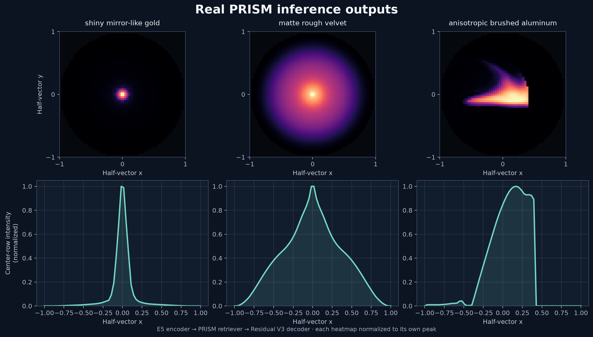

# PRISM

PRISM predicts a material normal-distribution-function (NDF) shape from a text prompt. It is a research prototype that returns a 64 × 64, single-channel NDF grid; it does not generate a complete PBR material or guarantee physically calibrated reflectance.

## Real model output



These 64 × 64 grids were generated by the released E5 encoder, PRISM retriever, and Residual V3 decoder. Heatmaps are normalized independently to show shape; profiles show the normalized center row. Recreate the figure with `python scripts/render_prism_showcase.py` after placing the E5 and PRISM release model assets in `out/prism_models/`.

## From prompt to NDF

The current inference path has three ONNX graphs, provided in two releases:

1. **E5 encoder** (`e5_encoder.onnx` and its external weights) encodes a `query: {prompt}` string as a normalized 1024-value vector. Tokenizer files are included in the [E5 release](https://github.com/JGolaszewski/PRISM/releases/tag/e5-onnx-v1.0.0).
2. **PRISM retriever** (`retriever.onnx`) combines five learned prototypes into a 16-value latent. Directional intent is supplied by the caller.
3. **Residual V3 Zernike decoder** (`vae_decoder.onnx`) maps the latent to a flattened 4096-value grid, which is reshaped to 64 × 64. Directional prompt detection and centroid recentering run outside the ONNX graphs.

The [PRISM release](https://github.com/JGolaszewski/PRISM/releases/tag/prism-onnx-v1.0.0) includes the retriever and decoder graphs with their external `.onnx.data` weights. Keep each sidecar beside its matching graph. Both releases include setup instructions and tensor details. The current graphs use fixed batch size 1 and were exported for ONNX Runtime CPU execution.

## Training data and provenance

The selected text retriever was fit on the canonical named-material text cache. The selected VAE was trained and evaluated on NDF grids derived from 100 MERL BRDF records and 62 RGL materials. MERL BRDFs are converted to normalized NDF-shaped proxies from their retroreflective slice; these are not standalone measured NDFs. The retriever uses E5 query embeddings and the VAE's 16-dimensional encoded material latents as prototypes.

The selected checkpoints do not use the experimental DTU/Nielsen, Ngan anisotropic, Cornell, Urban BRDF, or LUH cohorts. Those sources are not included in the released model assets. Dataset citations, terms, and transformations are summarized in [`THIRD_PARTY_NOTICES`](THIRD_PARTY_NOTICES).

## Set up the development environment

Requires Python 3.12. Create and activate a virtual environment from the repository root:

```powershell
py -3.12 -m venv .venv
.\.venv\Scripts\Activate.ps1
python -m pip install --upgrade pip
python -m pip install -r requirements.txt
```

If PowerShell blocks activation, call the venv interpreter directly with `\.venv\Scripts\python.exe`. The pinned PyTorch build targets CUDA 13.2. For CPU-only systems or a different CUDA stack, install a matching PyTorch build from the official [PyTorch installation selector](https://pytorch.org/get-started/locally/), then install the remaining requirements. Where supported, scripts accept `--device auto`, `--device cpu`, or `--device cuda`.

Downloaded datasets, trained checkpoints, generated caches, results, environments, and exports stay local. Do not commit raw data or checkpoints.

## Run the training and inference pipeline

From the activated virtual environment:

```powershell
# Download the canonical MERL and RGL source datasets
python scripts/download_datasets.py --dataset merl
python scripts/download_datasets.py --dataset rgl

# Convert BRDF inputs to 64 × 64 NDF grids and augment the training grids
python -m prism.preprocess
python -m prism.augment

# Train and validate the VAE
python -m prism.train --basis-type zernike --poly-degree 8 --latent-dim 16 --epochs 120 --batch-size 64 --beta 0.001 --peak-weight 30 --mse-weight 10 --lr 0.0003 --scheduler plateau --seed 42 --residual-decoder --residual-decoder-version 3 --checkpoint-dir checkpoints/zernike_residual_v3
python -m prism.validate --checkpoint checkpoints/zernike_residual_v3/best_model.pt

# Build the E5 caption/latent cache, train the text predictor, then evaluate
python -m prism.text_dataset --source grid --checkpoint checkpoints/zernike_residual_v3/best_model.pt --embedding-model intfloat/e5-large-v2
python -m prism.train_text --data-cache checkpoints/text_dataset_grid.npz --vae-checkpoint checkpoints/zernike_residual_v3/best_model.pt --checkpoint checkpoints/best_text_model.pt
python -m prism.eval_text --data-cache checkpoints/text_dataset_grid.npz --vae-checkpoint checkpoints/zernike_residual_v3/best_model.pt --text-checkpoint checkpoints/best_text_model.pt

# Generate a material NDF preview
python -m prism.infer_text --prompt "brushed aluminum" --output results/brushed_aluminum.png
```

These commands illustrate the development pipeline. Retraining does not necessarily reproduce the selected release bit-for-bit; model downloads may require Hugging Face access the first time.

## Export ONNX models

Install the export-only packages and run the exporter:

```powershell
python -m pip install onnx onnxscript onnxruntime
python scripts/export_prism_onnx.py
```

The selected text and VAE checkpoints must exist at the paths configured in the exporter, and the E5 model/tokenizer must be cached locally. The graphs and required sidecars are written to `out/prism_models/`.

## Releases

The [E5 release](https://github.com/JGolaszewski/PRISM/releases/tag/e5-onnx-v1.0.0) contains the encoder, external weights, and tokenizer files. The [PRISM release](https://github.com/JGolaszewski/PRISM/releases/tag/prism-onnx-v1.0.0) contains the retriever and decoder graphs with their external weights. Both releases are distributed separately because their model components have different licenses.

## License

PRISM source code is licensed under Apache-2.0; see [`LICENSE`](LICENSE). Third-party model and data rights are component-specific and listed in [`THIRD_PARTY_NOTICES`](THIRD_PARTY_NOTICES). The PRISM-trained model assets are designated CC BY-SA 4.0, subject to those notices; that designation does not apply to the separately licensed E5 model files.
